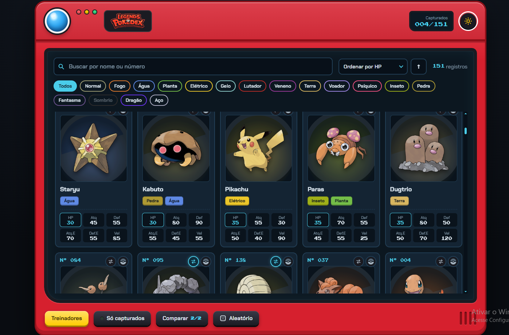
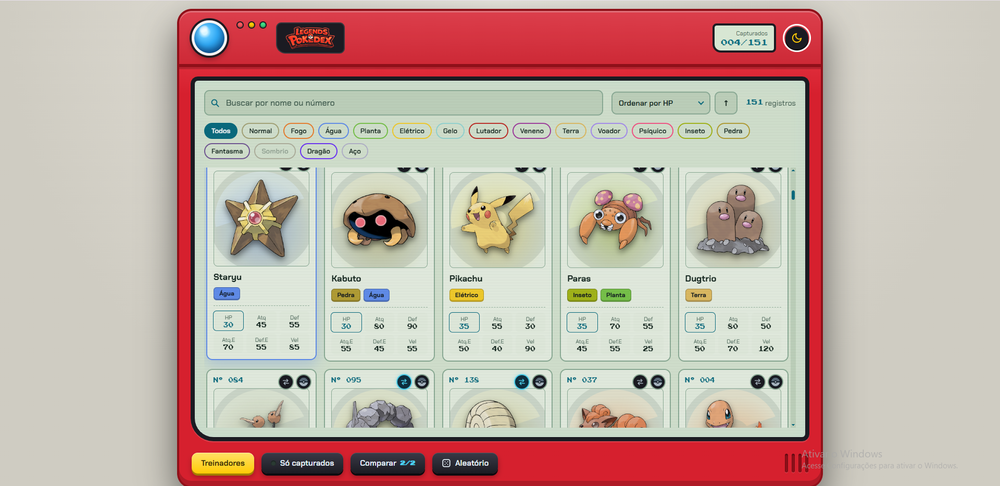
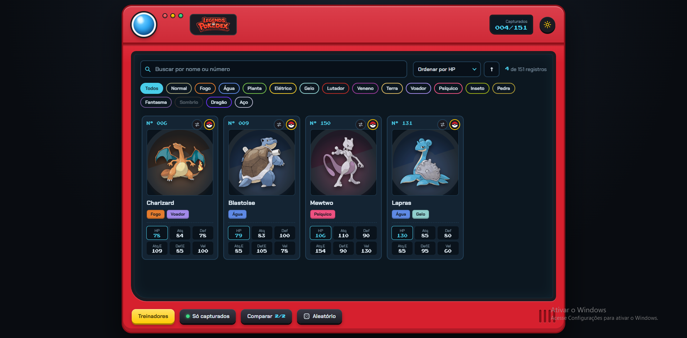
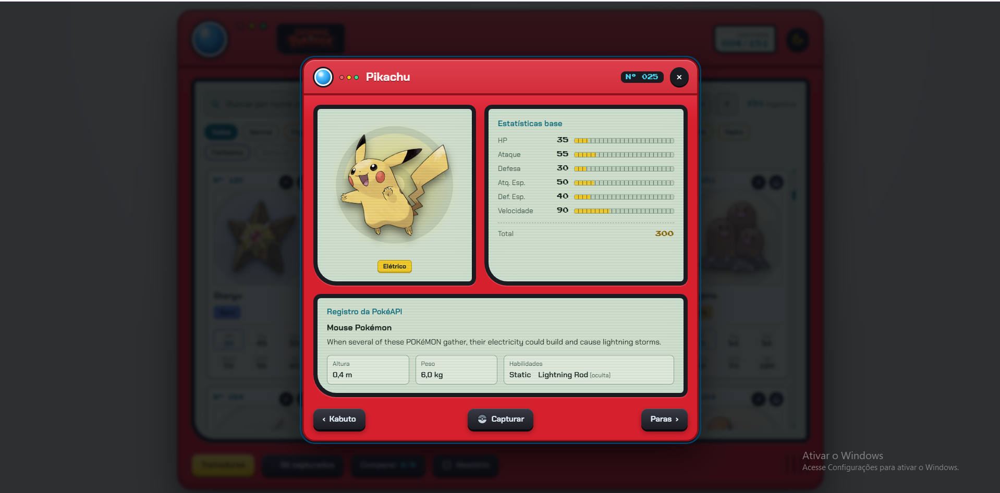
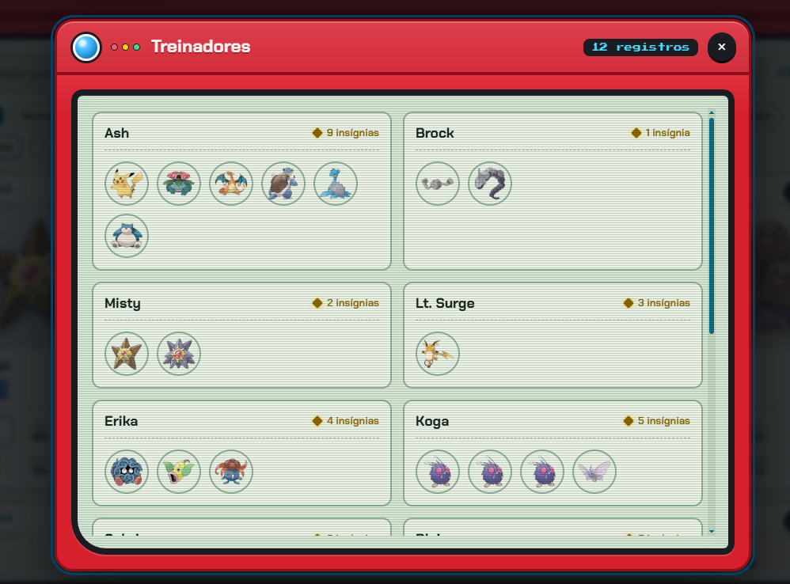
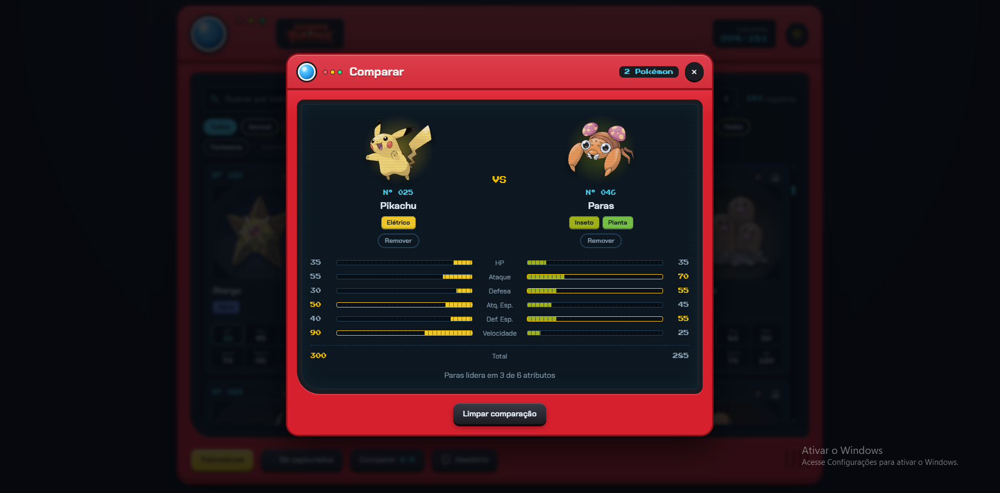

# 🔴 Legends Pokédex ⚡

> [!NOTE]
> Pokédex interativa desenvolvida em **React + Vite** com o visual e a experiência de uma Pokédex física clássica: carcaça vermelha, lente azul, LEDs piscantes e tela LCD responsiva.

## 🚧 Status do Projeto


## 📚 Índice

- [Sobre o Projeto](#-sobre-o-projeto)
- [Funcionalidades Principais](#-funcionalidades-principais)
- [Tecnologias Utilizadas](#-tecnologias-utilizadas)
- [Arquitetura](#-arquitetura)
- [Instalação e Execução](#-instala%C3%A7%C3%A3o-e-execu%C3%A7%C3%A3o)
  - [Pré-requisitos](#pr%C3%A9-requisitos)
  - [Como Executar a Aplicação](#-como-executar-a-aplica%C3%A7%C3%A3o)
- [Estrutura de Pastas](#-estrutura-de-pastas)
- [Demonstração](#-demonstra%C3%A7%C3%A3o)
- [Dados Utilizados & API Externa](#-dados-utilizados--api-externa)
- [Autores](#-autores)
- [Licença](#-licen%C3%A7a)

---

## 📝 Sobre o Projeto

A **Legends Pokédex** foi criada com o objetivo de unir design nostálgico e desenvolvimento web moderno.

* **Motivação:** Recriar a experiência física das Pokédex clássicas dos anos 90/2000, oferecendo uma interface envolvente com botões táteis, barras de atributos estilo LCD e efeitos visuais realistas.
* **Problema Resolvido:** Oferece uma ferramenta fluida para consulta rápida de dados Pokémon, comparação direta de estatísticas entre combatentes e controle pessoal de Pokémon capturados.
* **Público-Alvo:** Entusiastas de Pokémon, estudantes e desenvolvedores interessados em interfaces temáticas, componentização limpa e gerenciamento de estado em React.

> [!NOTE]
> A aplicação foi projetada para ocupar 100% da altura visível da tela (`100dvh`), eliminando rolagens globais no navegador e mantendo a rolagem restrita ao visor interno da Pokédex.

---

## ✨ Funcionalidades Principais

* 🔍 **Busca Dinâmica & Filtros:** Pesquisa por nome ou número formatado (ex: `#025` ou `Pikachu`) e filtragem por tipo via chips interativos.
* 📊 **Atributos em Medidores LCD:** Visualização detalhada de HP, Ataque, Defesa, Atq. Especial, Def. Especial e Velocidade.
* 🔀 **Ordenação Personalizada:** Ordene por número, nome ou por qualquer estatística individual em ordem crescente ou decrescente.
* 🥊 **Modal de Comparação (VS):** Selecione 2 Pokémon para comparar seus atributos lado a lado com barras de progresso animadas e resumo de liderança.
* 🔴 **Gerenciamento de Capturados (Favoritos):** Alterne o status de captura de cada Pokémon. O progresso fica salvo no `localStorage` e pode ser filtrado através do botão **"Só capturados"**.
* 📜 **Dados Biométricos via PokéAPI:** Detalhes de altura, peso, habilidades (com indicação de ocultas) e descrição oficial carregados dinamicamente sob demanda.
* 👤 **Modal de Treinadores:** Lista os treinadores clássicos (Ash, Brock, Misty, Erika, Giovanni, etc.), suas insígnias acumuladas e seus respectivos times de Pokémon.
* 🎲 **Modo Aleatório:** Sorteia um Pokémon com base nos filtros atualmente aplicados e abre sua ficha detalhada.
* 🌓 **Temas Dark / Retro LCD:** Alterne entre o tema escuro padrão e o tema claro estilo tela LCD verde-claro clássica.
* ♿ **Acessibilidade & Usabilidade:** Suporte a navegação por teclado (`Esc` para fechar modais, setas `←` `→` para navegar entre Pokémon), captura de foco em modais e suporte a `prefers-reduced-motion`.

---

## 🛠 Tecnologias Utilizadas

### 💻 Front-end

* **Biblioteca Principal:** [React 19](https://react.dev/)
* **Build Tool & Dev Server:** [Vite 6](https://vitejs.dev/)
* **Linguagem:** JavaScript (ES6+)
* **Estilização:** CSS3 Puro com Variáveis CSS, Flexbox, Grid e Animações Keyframes
* **Tipografia:** Google Fonts ([Chakra Petch](https://fonts.google.com/specimen/Chakra+Petch) & [Press Start 2P](https://fonts.google.com/specimen/Press+Start+2P))
* **Ícones & Gráficos:** SVG inline vetoriais e artes oficiais da PokéAPI

---

## 🏗 Arquitetura

O projeto adota uma arquitetura em componentes reutilizáveis e desacoplados, utilizando Hooks customizados para isolar a lógica de estado e persistência:

* **Custom Hooks:**
  * `useCaptured`: Gerencia o conjunto de Pokémon capturados e sincroniza automaticamente com o `localStorage`.
  * `useTheme`: Controla o tema (`dark`/`light`) e persiste a preferência no navegador.
  * `usePokemonExtra`: Consome a PokéAPI com suporte a cache em memória (`Map`) para evitar requisições repetidas e controle de cancelamento com `AbortController`.
* **Modais via Portals:** Uso de `React.createPortal` para renderizar janelas modais fora da árvore principal da DOM, mantendo a acessibilidade e o controle de foco.

---

## 🔧 Instalação e Execução

### Pré-requisitos

* **Node.js:** Versão **18.x** ou superior.
* **Gerenciador de Pacotes:** `npm` (incluso no Node) ou `yarn`.

### ⚡ Como Executar a Aplicação

1. **Clone o repositório:**
   ```bash
   git clone https://github.com/seu-usuario/pokedex-react-vite.git
   cd pokedex-react-vite
   ```

2. **Instale as dependências:**
   ```bash
   npm install
   ```

3. **Inicie o servidor de desenvolvimento:**
   ```bash
   npm run dev
   ```

4. **Acesse no navegador:**
   Abra o endereço indicado no terminal (normalmente **`http://localhost:5173`**).

#### Outros Comandos:
```bash
npm run build    # Gera a versão otimizada de produção na pasta /dist
npm run preview  # Serve a versão de produção localmente para verificação
```

---

## 📂 Estrutura de Pastas

```text
pokedex-react-vite/
├── public/
├── src/
│   ├── assets/
│   │   └── images/
│   │       ├── comparacao.png       # Screenshot do modal de comparação VS
│   │       ├── favoritos.png        # Screenshot da tela de capturados/favoritos
│   │       ├── home-dark.png        # Screenshot da tela inicial no tema escuro
│   │       ├── home-ligth.png       # Screenshot da tela inicial no tema claro LCD
│   │       ├── Logo.png             # Logo principal Legends Pokédex
│   │       ├── stats.png            # Screenshot dos detalhes e estatísticas do Pokémon
│   │       └── treinadores.png      # Screenshot do modal de treinadores
│   ├── components/
│   │   ├── ComparisonModal.jsx      # Modal de comparação lado a lado (VS)
│   │   ├── Icons.jsx                # Ícones vetoriais em SVG
│   │   ├── Modal.jsx                # Estrutura base de modal acessível
│   │   ├── Pokeball.jsx             # Ícone de Poké Bola em SVG
│   │   ├── PokemonCard.jsx          # Card individual do Pokémon
│   │   ├── PokemonDetails.jsx       # Modal de detalhes com estatísticas e dados extras
│   │   ├── PokemonList.jsx          # Lista e grade de cards com estado vazio
│   │   ├── SearchBar.jsx            # Barra de pesquisa, ordenação e filtros de tipo
│   │   ├── TrainersModal.jsx        # Modal com treinadores e suas insígnias
│   │   └── TypeBadge.jsx            # Tag colorida do tipo do Pokémon
│   ├── css/
│   │   ├── ComparisonModal.css
│   │   ├── index.css                # Tokens de design, temas, carcaça e regras globais
│   │   ├── Modal.css
│   │   ├── PokemonCard.css
│   │   ├── PokemonDetails.css
│   │   ├── PokemonList.css
│   │   ├── SearchBar.css
│   │   └── TrainersModal.css
│   ├── data/
│   │   └── pokedex-data.json        # Dados locais de Pokémon, estatísticas, tipos e treinadores
│   ├── hooks/
│   │   ├── useCaptured.js           # Hook para controle e persistência de capturados
│   │   ├── usePokemonExtra.js       # Hook para requisição e cache de dados da PokéAPI
│   │   └── useTheme.js              # Hook para alternância de tema Claro/Escuro
│   ├── utils/
│   │   └── pokemon.js               # Funções utilitárias de ordenação, formatação e cores
│   ├── App.jsx                      # Componente principal e orquestração de estado
│   └── main.jsx                     # Ponto de entrada da aplicação
├── index.html
├── package.json
└── vite.config.js
```

---

## 🎥 Demonstração

### 🌐 Visão Geral da Pokédex

| Modo Escuro (Dark Mode) | Modo Claro (LCD Nostálgico) |
| :---: | :---: |
|  |  |
| *Visual escuro padrão com telas azuladas* | *Visual verde-claro nostálgico das Pokédex de LCD* |

### 🔍 Filtros, Detalhes e Comparação

| Filtro "Só Capturados" | Detalhes & PokéAPI |
| :---: | :---: |
|  |  |
| *Exibição apenas dos Pokémon marcados como capturados* | *Estatísticas base e dados biográficos da PokéAPI* |

| Modal de Treinadores | Modal de Comparação (VS) |
| :---: | :---: |
|  |  |
| *Treinadores com insígnias e atalhos para os Pokémon do time* | *Comparativo direto de estatísticas com medidores LCD* |

---

## 📊 Dados Utilizados & API Externa

* **Dados Locais (`pokedex-data.json`):** Fonte primária com informações dos 151 Pokémon, contendo IDs, nomes, tipos, atributos base e dados dos treinadores da região de Kanto.
* **PokéAPI (`https://pokeapi.co`):** Utilizada via `fetch` assíncrono para enriquecer o registro da Pokédex no modal de detalhes com:
  * Categoria do Pokémon (ex: *Mouse Pokémon*);
  * Texto descritivo oficial da Pokédex;
  * Altura (convertida para metros) e Peso (convertido para quilos);
  * Lista de Habilidades e Habilidades Ocultas.

---

## 👥 Autores

| 👤 Nome | 🖼️ Foto | :octocat: GitHub | 💼 LinkedIn 
| :--- | :---: | :---: | :---: | :--- |
| **Integrante 1** |  | [GitHub](https://github.com/gustavoryan-del) | [LinkedIn](https://linkedin.com/in/gryangomesguedes) 
| **Integrante 2** |  | [GitHub](https://github.com/user2) | [LinkedIn](https://linkedin.com/in/user2) 

---

## 📄 Licença

Este projeto é distribuído sob a licença **MIT**. Veja o arquivo `LICENSE` para mais detalhes.